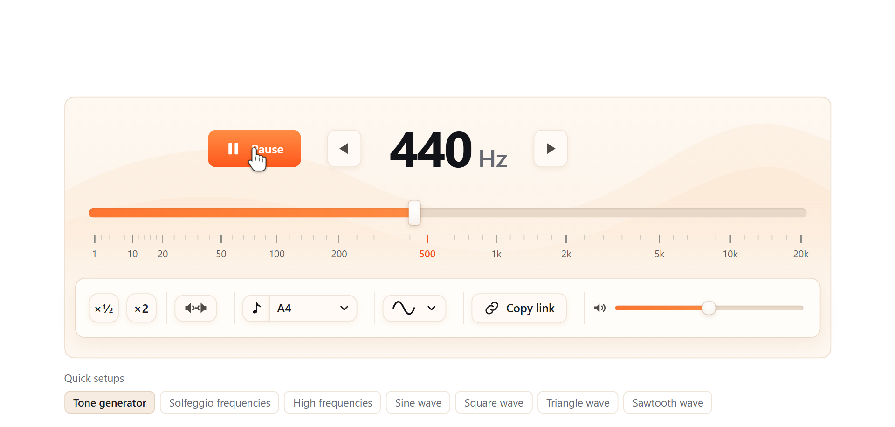

# Online Tone Generator: any frequency from 1 Hz to 20 kHz

**[Open the online tone generator](https://toolster.net/tone_generator)**. Free, no install, works in any modern browser on desktop and phone.



Play a steady tone at the exact frequency you need. Type a number in hertz, drag the slider or pick a musical note, then press Play.

## Features

- Steady tone from 1 Hz to 20 kHz
- Fine tuning in steps of 1, 0.01 and 0.001 Hz
- Sine, square, triangle and sawtooth waves
- Note picker from C0 to B8 (A4 = 440 Hz)
- Left, right or both channels
- Copy link: the frequency, volume, waveform and balance are saved in the address

## What people use it for

- **Headphone and speaker check.** Send the tone to the left or right channel and make sure each side plays.
- **Subwoofer and bass test.** Sweep the slider down to 20 Hz and find where your speakers stop.
- **Hearing range.** Find the highest tone you can still hear.
- **Tinnitus frequency matching.** Move the frequency until it sounds like the ringing you hear.
- **Tuning and music.** Use a clean reference pitch for an instrument or for ear training.
- **Physics lessons.** Show how pitch and waveform change the sound.

## Video

- [Online tone generator, short walkthrough](https://youtu.be/G-cPprO-a_Q)

## Note frequency table

[`note-frequencies.csv`](note-frequencies.csv) lists every note from C0 to B8 in equal temperament with its MIDI number and frequency for A4 = 440 Hz and A4 = 432 Hz. Free to use in your own projects.

## Helper scripts

Small Node.js scripts, no dependencies (Node 18+):

```bash
npm run notes                                   # rebuild note-frequencies.csv
node scripts/make-test-tone.js 1000 10 1khz.wav # 10 s sine test tone as WAV
npm test                                        # check the table and the WAV writer
```

## More

- [About the tone generator](ABOUT.md): how it works, keyboard shortcuts, safety notes
- Other languages: [Генератор тона (RU)](https://ru.toolster.net/tone_generator), [Generador de tonos (ES)](https://es.toolster.net/tone_generator)
- 240+ free browser tools: [toolster.net](https://toolster.net)

Found a bug or want a feature? [Open an issue](../../issues).

The tone generator itself is a hosted web app, its source code is not published here. The helper scripts are MIT licensed. The note table and texts are free to reuse with a link back.
